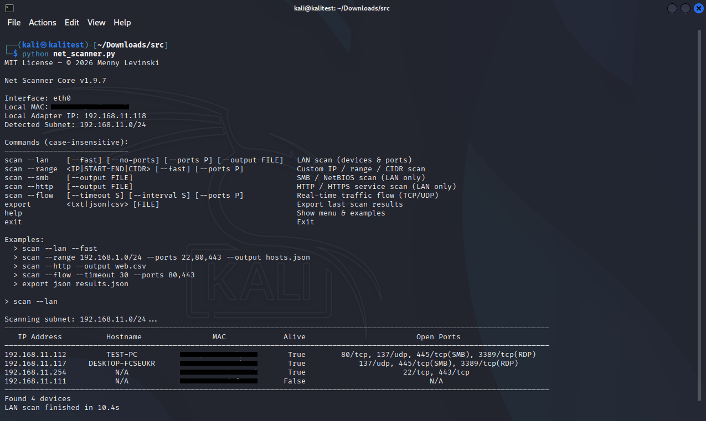
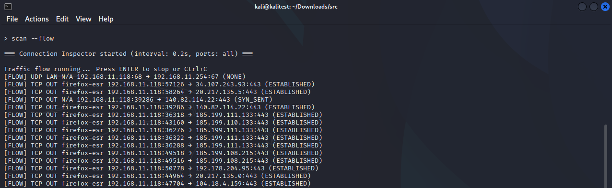

<div align="center">

#  Net Scanner Core

</div>

<br>

<div align="center">
<a href="#overview"><b>Overview</b></a> &nbsp; ✦ &nbsp;
<a href="#installation"><b>Installation</b></a>
</div>

<br>

<a name="overview"></a>


**Net Scanner Core** is a cross-platform Python network scanner that enables device discovery and open port detection across local IPv4 subnets, including Wi-Fi and Ethernet.
Built for ethical diagnostics, security awareness, and administrative auditing, it is suitable for both personal and organizational use.

If you would like to contribute, I would greatly appreciate it. Please read the [contribution guidelines](CONTRIBUTING.md).

Licensed under the [MIT License](LICENSE).

---

## ✨ Features

- **LAN Detection Mode**, detects your IPv4 subnet and scans the local network incrementally
- **Custom Scan Mode**, target a specific IP address, IP range, or CIDR block (e.g., `192.168.1.0/24`)
- **HTTP Service Scan**, identifies HTTP/HTTPS web services running on discovered hosts
- **Fast & Accurate**, combines ICMP, ARP (`ip neigh` / `arp -a`), and bounded TCP/UDP probes
- **Port Detection**, scans common TCP and UDP service ports with protocol tags and risky-port labels
- **SMB / NetBIOS Scan**, detects reachable SMB services and safe anonymous share exposure
- **Traffic Flow Inspection**, real-time monitoring of active TCP and UDP connections (`0.2s` default interval)
- **CLI & Export Support**, interactive menu or non-interactive flags (`--lan`, `--range`, `--http`, `--smb`, `--flow`) with TXT, JSON, and CSV export

For a complete list of the common ports scanned by the tool, see [PORTS.md](PORTS.md)

---

## 📸 Kali Linux





---

## ✔️ Lawful Use

This tool is intended solely for lawful and authorized use.
You must obtain explicit permission from the network owner before scanning, auditing, or testing any systems.
The author assumes no liability for misuse or for actions that violate applicable laws or organizational policies.
Use responsibly and in compliance with your local governance.

---

## 📌 Safety Notice

**Net Scanner Core** is safe to use when downloaded from the official source.
Because the application performs network discovery and scanning, some antivirus products may incorrectly flag or restrict its execution. This is a common false positive for legitimate network diagnostic tools.
If you trust this application, you may need to add it as an exception in your antivirus software.

---

<a name="installation"></a>
## 💾 Installation

### 🐍 Cross-platform

#### 1️⃣ Requirements
- Python **3.8+**
- Works on **Windows** & **Linux**
- Dependencies: `pip install -r requirements.txt` (`psutil`, `requests`)

#### 2️⃣ Script
- Clone the repository or run [net_scanner.py](src/net_scanner.py)

#### 3️⃣ Run
- Interactive mode *(opens maximized; pass `--no-maximize` to disable)*:
  - Windows: `python src/net_scanner.py`
  - Linux: `python3 src/net_scanner.py`
  - Example interactive commands:
    - `> scan --lan --fast`
    - `> scan --range 192.168.1.0/24 --ports 22,80,443 --output hosts.json`
    - `> scan --http --output web.csv`
    - `> scan --flow --timeout 30 --ports 80,443`
    - `> export json results.json`
- Non-interactive CLI examples:
  - `python src/net_scanner.py --lan --output lan_scan.json`
  - `python src/net_scanner.py --range 192.168.1.0/24 --fast --output hosts.csv`
  - `python src/net_scanner.py --http`
  - `python src/net_scanner.py --flow --timeout 30 --ports 80,443`

---

## 📁 Project Structure

```bash
net_scanner_core/             # Main project folder
│
├── img/                  # Screenshots and UI assets
│
├── src/                  # Core application source code
│   ├── net_scanner.py    # Entrypoint and public facade
│   └── scanner/          # Modular scanning components
│       ├── config.py     # Constants, ports, probes, OS helpers
│       ├── network.py    # Interface, ping, ARP, hostname resolution
│       ├── ports.py      # Bounded TCP/UDP port scanner
│       ├── discovery.py  # Incremental LAN/range host discovery
│       ├── http_probe.py # HTTP/HTTPS service probing
│       ├── smb.py        # SMB/NetBIOS detection and share check
│       ├── inspector.py  # Real-time TCP/UDP traffic flow monitor
│       ├── export.py     # Logging, table rendering, TXT/JSON/CSV export
│       └── cli.py        # Interactive menu and argparse CLI
│
├── tests/                # Unit test suite
├── CHANGELOG.md          # Version history
├── CONTRIBUTING.md       # Contribution guidelines
├── LICENSE               # Project license
├── PORTS.md              # List of all common ports scanned by the tool
├── pyproject.toml        # Package metadata & console script config
├── README.md             # Main documentation
├── requirements.txt      # Python dependencies
├── SECURITY.md           # Security policy
└── .gitignore
```
